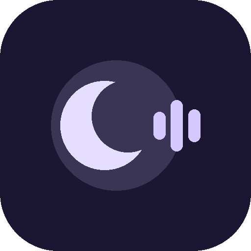
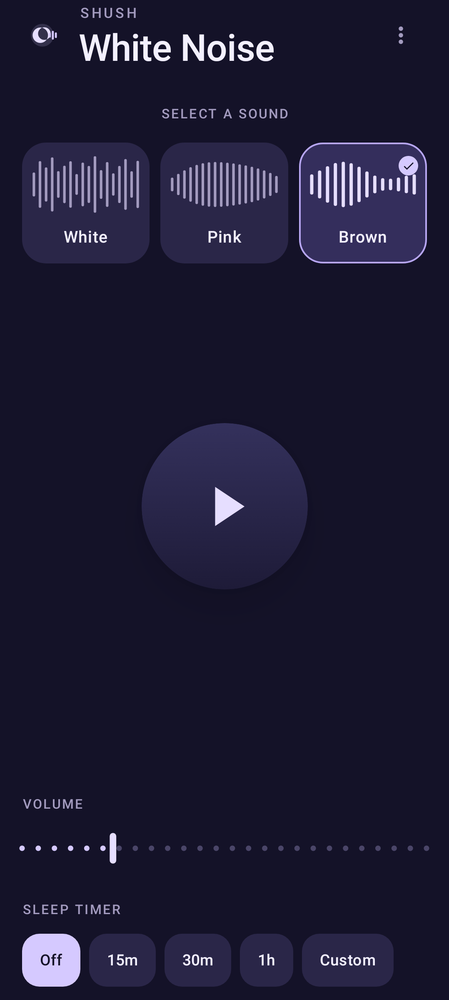
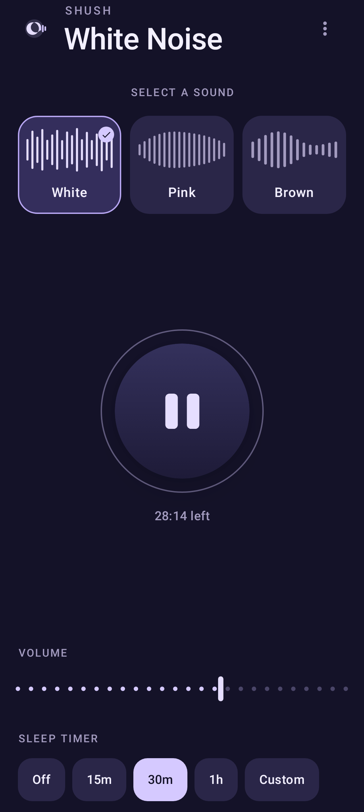
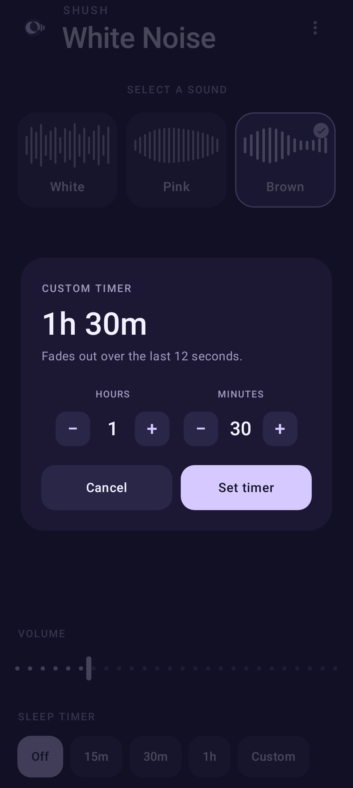
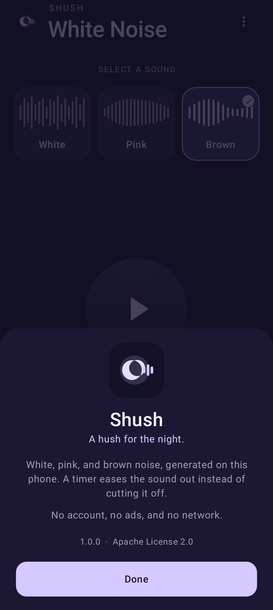
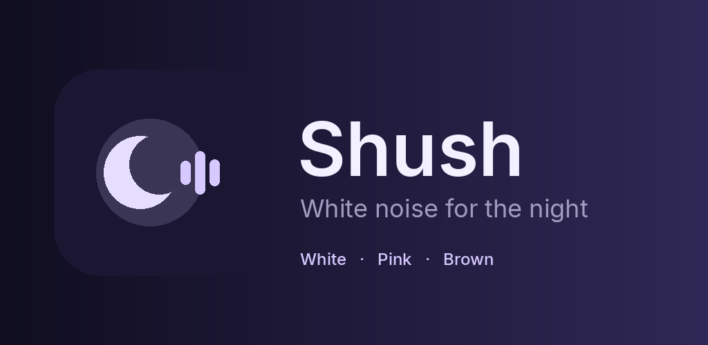

# Shush

<p>
  
</p>

Shush is a white-noise app for Android. Pick white, pink, or brown noise, set how loud it is, and leave it running. A sleep timer can fade the sound out instead of cutting it off.

The phone generates the sound. There is no account, no ads, and no network permission. The project is Apache 2.0.

Minimum Android version is 8.0 (API 26). The application id is `com.galynte.shush`.

## Get the app

Install a debug build from source, or take the APK from a [GitHub release](https://github.com/Galynte/Shush/releases) once a version is tagged. Play Store hosting uses the AAB from that same release. See [PUBLISHING.md](PUBLISHING.md).

## Screenshots

| Night stand | Playing |
| :---------: | :-----: |
|  |  |

| Custom timer | About |
| :----------: | :---: |
|  |  |

## What it does

* **Three sounds.** White is a steady full-spectrum hush. Pink is softer, like rain on a roof. Brown is deep, like a distant ocean. Switching sounds does not stop playback.
* **One play button.** Playback continues with the screen off. The notification can pause or stop it, and the channel itself is silent.
* **Volume.** The slider is the app's own level, so a quiet night setting stays put when you come back.
* **Sleep timer.** Off, 15 minutes, 30 minutes, 1 hour, or a custom length from 1 minute to 23 hours 59 minutes. Pausing freezes the countdown. The last 12 seconds fade to silence.
* **Lock screen.** A media session exposes play, pause, and stop, including from a connected headset.

## Brand

The name is Shush. The line under it is "A hush for the night."

The mark is a crescent with three short bars in the opening, a sound getting quieter rather than a siren. It is drawn the same way in the app, the launcher, and the Play graphic. Source for the bitmap sizes is `tools/render_brand.py`. An SVG sits at `docs/assets/brand/shush-mark.svg`.

| Role | Hex |
| --- | --- |
| Night background | `#141228` |
| Raised surface | `#1C1834` |
| Sound card | `#2A2648` |
| Selected card | `#342E5C` |
| Lavender | `#D5C9FF` |
| Moon | `#E6DEFF` |
| Text | `#F3F0FF` |
| Muted text | `#A39BBF` |
| Icon background | `#1B1733` |

The wordmark in the Play feature graphic is set in Inter. The app uses the system sans so it does not ship a second font. The screen stays on the night palette in light and dark system themes, because it is meant to be opened in a dark room.



## Privacy

Settings stay on the device. The full policy is [PRIVACY.md](PRIVACY.md).

## Build

Debug APK:

```bash
./gradlew assembleDebug
```

The file is `app/build/outputs/apk/debug/app-debug.apk`.

Unit tests, including the screenshot render:

```bash
./gradlew testDebugUnitTest
```

Fresh screenshots are written to `app/build/screenshots/`. The copies in `docs/assets/images/` are the ones this README shows.

Release bundles and the tag pipeline are described in [PUBLISHING.md](PUBLISHING.md).

## License

Apache License 2.0. See [LICENSE](LICENSE) and [NOTICE](NOTICE).
